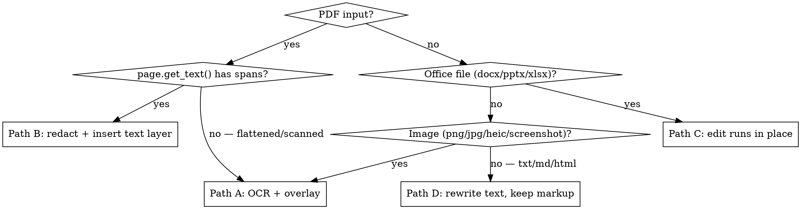

# Translate a document into English + bilingual copies

Take one input file in any language and hand back **two** files that look like the original:

1. `<base>.en.<ext>` — every non-English string replaced by English.
2. `<base>.en-zh.<ext>` — the same, but each replacement carries English **and** Simplified
   Chinese (EN on top, 中文 below). Swap Chinese for another second language only if the user
   asks.

`<base>` is the original filename with its title translated to English (a Hebrew filename
stays readable nowhere — rename it). `<ext>` mirrors the source format; fall back to the
nearest editable format only when in-place editing is impossible.

**What gets translated:** every human-language string that isn't already English.
**What stays untouched:** numbers, dimensions, dates (keep the source's date format), phone
numbers, brand logos and wordmarks, and all geometry/artwork. Currency and unit *words* in
the source script are the one exception inside numbers: convert the word to its standard
symbol or English abbreviation, never the amount (500円 → ¥500, 平米 → m²). Transliterate person names
(Hila, Dan — 希拉, 丹); keep brand names in Latin unless the bilingual copy reads
inconsistently, then transliterate for script consistency.

**The single most important principle: you are the ground-truth reader.** OCR tells you
*where* text sits; your own eyes on the rendered page tell you *what* it says. Never ship a
translation of a string you haven't personally read in the source image, and never trust OCR
output for content — engines mangle scripts they half-support and silently miss labels.

Work in the session scratchpad; deliver only the two output files.

## Pick the pipeline



A drawing exported from CAD/design tools usually reports **zero** text spans — the text is
outlined curves or baked into raster — even though it "looks like" a digital PDF. Check with
`page.get_text("dict")` before assuming; images and non-text blocks mean Path A. Paths B–D are
sketched in [references/formats.md](references/formats.md); the rest of this file is Path A,
which is the hard one.

## Path A: OCR + overlay (flattened PDFs, scans, images)

The strategy: find every foreign-language string's bounding box, translate it, then patch the
original file in place — cover each string with a background-matched patch and draw the
translation exactly where the original sat. The original PDF's vectors, images and fonts are
never re-created, so everything you don't touch stays pixel-identical.

The bundled overlay CLI handles PDF plus PNG/JPEG raster input and writes PNG/JPEG raster output
at the source pixel dimensions. Convert HEIC to PNG before this path; retain the PNG output rather
than claiming an unsupported HEIC re-encode.

**Setup:** the whole path needs PyMuPDF. The package is `pymupdf` — **not** `fitz`, which is
an unrelated broken package on PyPI:

```bash
python3 -c "import fitz" 2>/dev/null || pip3 install pymupdf   # or: uv pip install pymupdf
```

### 1. Read every page yourself

Render at 150 dpi and *look at it* (Read the PNGs — all of them, not just page 0). Before any
tooling, write down an inventory: every non-English string, which page it's on, where it
sits, and what it means. This inventory is the authority everything else gets checked
against. Steps 1–2 repeat per page; every later gate is per page too.

```python
import fitz
doc = fitz.open("source.pdf")
for pno, page in enumerate(doc):
    page.get_pixmap(dpi=150).save(f"page{pno}.png")
    print(pno, page.get_text("dict")["blocks"])   # confirm: no text spans -> Path A
```

### 2. Get boxes from OCR — content from your eyes

Run OCR to get precise boxes (render at 200 dpi for this — 150 dpi on Windows; keep the dpi
you used, all box math depends on it). Pick the engine by platform — `platform.system()` /
`uname` decides, never ask the user. Details, the word-clustering recipe, and the coordinate
math live in [references/ocr-pipeline.md](references/ocr-pipeline.md):

- **macOS → Apple Vision** (`assets/ocr_vision.swift`, zero install): excellent boxes, but
  **check language support first** (`--list-langs`) — it has *no Hebrew*, and prints garbage
  Latin/Cyrillic for scripts it lacks. Garbage text with a good box is still a good box.
- **Windows → Windows.Media.Ocr** (`assets/ocr_windows.ps1`, zero install, run with
  `powershell.exe` 5.1): word-level boxes; language coverage = installed language packs
  (*including* Hebrew, unlike Vision) — check `-ListLangs`. Input is capped at ~2600 px
  (`MaxImageDimension`), hence the 150 dpi rendering on Windows.
- **Any OS → tesseract** (brew / winget / apt + one traineddata download): covers ~100
  languages; the fallback when the native engine lacks the script, and the primary engine on
  Linux.

Cluster word-level boxes (tesseract, Windows OCR) into labels with a tight horizontal gap
(< 80 px @200 dpi, scale with dpi) — naive line-grouping merges labels across whole columns.

Merge both engines' boxes with your inventory. Every inventory item needs a box; a box with
no inventory item is either a number (leave it) or something you missed (look again).

### 3. Build the spec

One JSON drives everything (`assets/spec-example.json` shows the shape):

```json
{"dpi": 200, "labels": [
  {"id": 1, "page": 0, "bbox": [2884, 266, 276, 72], "he": "מלון מטיילים",
   "en": "Travelers' Hotel", "zh": "旅行者酒店", "style": "white"}]}
```

- `bbox` is `[x, y, w, h]` in **pixels at the spec's dpi**, top-left origin; `page` routes
  multi-page documents.
- `style: "white"` — text on plain background (title blocks, technical plans): white patch,
  black text. `style: "chip"` — text baked into a photo/render: rounded chip filled with the
  sampled surrounding color, white text.
- `"cell": false` (white style only, default `true`) marks a free-standing label on open
  background — its patch may widen up to 1.3x so the text renders at a comfortable size.
  Leave the default for anything inside a table cell.
- Stacked source lines (a two-line slogan, a caption pair, a bullet list) need three more
  per-label flags: `"grow": false` — the default bilingual height growth would collide with
  the neighboring line's text; instead size each bbox to the full band the line may occupy
  (share the inter-line gaps). `"align": "left"` — for list rows whose bullet dots stay on
  the page; centered text next to left-anchored dots reads wrong. `"max_fs"` set to the
  same value on sibling labels — English inverts source width proportions, so per-label
  fitting renders one line of a pair bigger than the other.
- Keep the source string (`he` here — key it by language) in the spec: reviewers need it.

### 4. Verify boxes with a debug overlay — before generating anything

Draw numbered rectangles from the spec onto a throwaway copy of the doc, render every page
that has labels, and *look*:

```python
doc = fitz.open("source.pdf")            # fresh copy — never save this one
s = 72 / spec["dpi"]
for lab in spec["labels"]:
    page = doc[lab.get("page", 0)]
    x, y, w, h = lab["bbox"]
    r = fitz.Rect(x*s, y*s, (x+w)*s, (y+h)*s)
    page.draw_rect(r, color=(1,0,0), width=1.2)
    page.insert_text(fitz.Point(r.x0-14, r.y1), str(lab["id"]), fontsize=9, color=(1,0,0))
for pno in {lab.get("page", 0) for lab in spec["labels"]}:
    doc[pno].get_pixmap(dpi=150).save(f"debug{pno}.png")
```

The numbers matter: on a dense page they're how you map a bad rectangle back to its spec
entry for refinement.

Any box that doesn't sit exactly on its text: crop that region at 600 dpi, measure the true
extent, and convert back (`pt = crop_origin + px/(dpi/72)`, then `spec_px = pt * dpi/72`).
Off-by-a-little matters — a box 16 px short leaves a sliver of source text peeking out of the
patch in the final output.

### 5. Verify the translations with fresh eyes

Translation errors survive self-review. Fan out independent reviewer subagents, one per lens,
each told to *refute*:

- **Source accuracy** — re-reads every string in the image at high zoom against the spec, and
  checks the English is what this document type would actually say (drawing stamps say "For
  Construction", not the calque "For Execution").
- **Target register** — a native-level reviewer for the second language: is each rendering
  what a real Chinese drawing/contract/menu would print? (图号 not 图纸 for a sheet number;
  睡眠区 not 睡床区; occupancy 两大三小 not the calque 夫妻+3.)
- **Completeness** — sweeps the whole page at zoom hunting text the spec missed; dimension
  numbers and logos excluded.

Apply must-fixes; take suggestions unless they conflict. If subagents are unavailable, do
each pass yourself in separate, deliberate passes at high zoom.

### 6. Generate and inspect

```bash
python3 assets/overlay_translate.py spec.json source.pdf "Out.en.pdf" --mode en
python3 assets/overlay_translate.py spec.json source.pdf "Out.en-zh.pdf" --mode en+zh
```

The script encodes the hard-won layout rules — keep them if you rewrite it:

- **All patches draw before any text** (two passes). Otherwise a later patch erases an
  earlier label's text whenever boxes touch.
- **Bilingual growth is bounded in tables**: a two-line EN+ZH label needs extra height, but a
  patch that grows past its table cell wipes out border lines and collides with neighbors.
  Cell-bound (`white`) patches cap at 1.5× original height; free labels (chips, and white
  with `"cell": false`) may double in height and also widen.
- **One font size per label**: English is usually *wider* than a compact CJK or Hebrew
  source, and fitting each line independently ships tiny English over large 中文. The script
  fits both lines at the shared minimum; when that lands too small, mark the label
  `"cell": false` (or widen its bbox) rather than accepting a 5 pt line.
- **CJK needs a CJK-capable font**: the base-14 fonts (helv) don't fail on 中文 — they
  silently draw bullets. The script auto-detects a system font per OS (Arial Unicode on
  macOS, Microsoft YaHei on Windows, Noto Sans CJK on Linux) and falls back to PyMuPDF's
  built-in CJK font (`fontname="china-s"`), which works everywhere with no font file.

Render both outputs and compare against the source — **every page**, at full page *and* at
zoom on every dense region. Ship only when: no source-language fragment peeks out anywhere,
no text is clipped by a neighboring patch, no table border got painted over, and the
untouched artwork is intact.

## Quick reference

| Task | Command |
|---|---|
| Text layer present? | `fitz.open(f)[0].get_text("dict")["blocks"]` — type-0 blocks with spans |
| Render for OCR | `page.get_pixmap(dpi=200).save("p.png")` |
| Vision OCR (macOS) | `swift assets/ocr_vision.swift p.png "ja-JP,en-US"` → JSON boxes |
| Vision language check | `swift assets/ocr_vision.swift --list-langs` — no Hebrew! |
| Windows OCR | `powershell -ExecutionPolicy Bypass -File assets/ocr_windows.ps1 p.png he` |
| Windows language check | `powershell -ExecutionPolicy Bypass -File assets/ocr_windows.ps1 -ListLangs` |
| tesseract + language | `brew install tesseract` / `winget install UB-Mannheim.TesseractOCR` / `apt install tesseract-ocr` + traineddata → see references/ocr-pipeline.md |
| Generate outputs | `overlay_translate.py spec.json src out --mode en` / `--mode en+zh` |
| px ↔ pt | `pt = px * 72/dpi` — the spec stores px at `spec["dpi"]` |

## Common mistakes

| Mistake | Reality |
|---|---|
| Trusting OCR text for content | Engines mangle half-supported scripts. Boxes yes, strings no — read the page yourself. |
| Assuming Vision reads every language | It has no Hebrew at all; it prints plausible garbage instead of failing. Check `--list-langs`. |
| Forgetting vertical/rotated text | Vision returns an *empty* result for vertical CJK columns (exit 0); tesseract needs `jpn_vert`-style traineddata. Your visual inventory is what catches the miss — see references/ocr-pipeline.md. |
| Verifying only page 0 | Every gate — inventory, debug overlay, final compare — runs per page. A clean page 0 says nothing about page 3. |
| Grouping OCR words by line number only | Merges labels across columns into one giant box. Cluster with a tight horizontal gap. |
| Skipping the debug-overlay pass | A box 16 px short leaves source-text slivers in the shipped file. Look before you patch. |
| Drawing each label's patch+text together | A later patch paints over an earlier label's text. Patches first, all of them, then text. |
| Growing bilingual patches freely in tables | Wipes cell borders, collides with the next row. Cap growth inside cells; let only photo chips grow. |
| Literal calques in either language | "For Execution", 夫妻+3, 图纸: 1 — translate to what the document *type* would print. Verify with per-language reviewer passes. |
| Translating numbers, dates, logos | They stay. Translating them adds errors and churn for zero value. |
| One label translated, its duplicate missed | The same label often appears multiple times (two "Bed Area" zones). The completeness sweep exists for this. |

## Bundled resources

| File | What it is |
|---|---|
| `assets/ocr_vision.swift` | macOS: Apple Vision OCR → JSON `{text, conf, x, y, w, h}` in pixels, top-left origin |
| `assets/ocr_windows.ps1` | Windows: Windows.Media.Ocr → same JSON shape, word-level (cluster like tesseract); `-ListLangs` for installed packs |
| `assets/overlay_translate.py` | Spec-driven patch+text overlay; `--mode en` / `en+zh`; white/chip styles, two-pass drawing, cell-safe growth, per-OS CJK font auto-detect |
| `assets/spec-example.json` | Minimal working spec: one white label, one chip label |
| `references/ocr-pipeline.md` | Engine selection, tesseract setup incl. the `--tessdata-dir` config trap, word clustering, coordinate math, box refinement by 600 dpi crops, vertical/rotated text |
| `references/formats.md` | Paths B–D: text-layer PDF redaction, docx/pptx/xlsx in-place editing, txt/md/html, plus multi-page and RTL notes |
